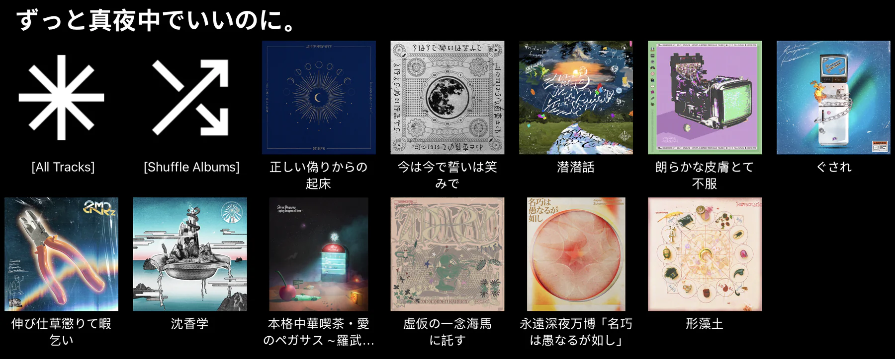
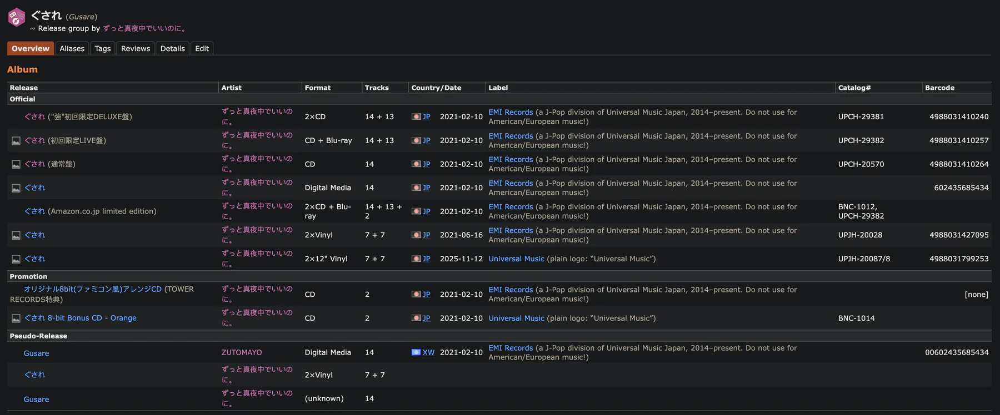
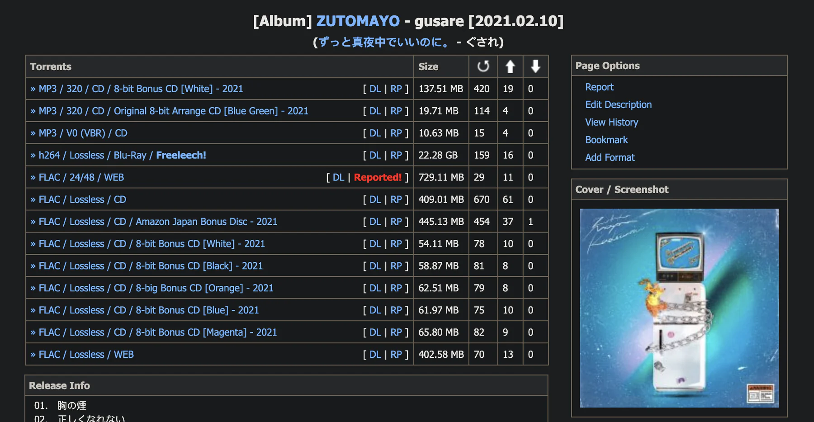
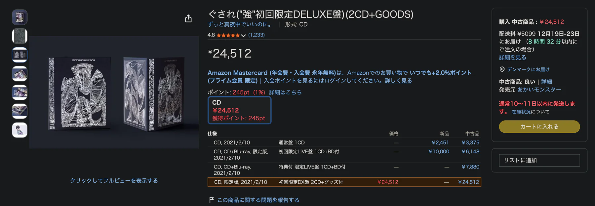

+++
title = "Limited Editions Create Lost Media"
date = 2026-11-24
description = ""
+++

The other day, I was enjoying my music collection and listening to one of my favorite bands, [ずっと真夜中でいいのに。](https://zutomayo.net/) (ZUTOMAYO).
I noticed that only for this one album, [ぐされ](https://zutomayo.net/release/16/), this band's second full album release, I have the normal edition in my collection rather than the limited edition.

My ZUTOMAYO album collection, with only ぐされ being not some form of limited edition.

For some background, I usually prefer to collect the limited edition of an album, seeing that it typically includes some bonus tracks that are not available in the normal edition. Specific to ぐされ, the ["強"初回限定DELUXE盤](https://musicbrainz.org/release/df51bb91-97be-40f4-a77f-c552d418bc82) (first press limited edition) additionally includes the off-vocal version of each track. Among the other limited edition releases of this album, this first press limited edition is also the only one to include those off-vocal versions, while other limited editions bundle the normal edition CD and a live performance Blu-ray.

All released editions of ぐされ listed on MusicBrainz.

I did some research trying to find this first press limited edition.
Digital music storefronts, like [Qobuz](https://www.qobuz.com/dk-en/album/gusare-zutomayo/uqhql9zury9aa), [iTunes](https://music.apple.com/jp/album/gusare/1548835870), and [Mora](https://mora.jp/package/43000006/00602435685434/), do not have it, which is expected, since such storefronts usually only sell the normal editions of albums.
Piracy download sites where I can typically source some obscure limited editions are also no luck for this one. Public piracy platforms mainly focus on Western media, so most of the ones I looked at do not even have any ZUTOMAYO albums. On the most comprehensive private torrenting platform focused specifically on East Asian music that I know and have access to, I can find the normal edition and all the limited editions, except for this first press limited edition.

Every limited edition of this album is available on this private torrenting platform, except for the one I am looking for.

It seems that my only option is to purchase the physical album of this edition. Surprisingly, [Amazon Japan](https://www.amazon.co.jp/%E3%81%90%E3%81%95%E3%82%8C-%E5%BC%B7-%E5%88%9D%E5%9B%9E%E9%99%90%E5%AE%9ADELUXE%E7%9B%A4-2CD-GOODS/dp/B08MFWFHC3) still lists it, with only second-hand options though. As the name suggests, this edition was probably only produced for the first batch, and I am lucky that I can even find any second-hand options.

Amazon Japan still lists this first press limited edition with a few 中古 (second-hand) options left.

This experience got me thinking: once these physical copies cease to exist, those off-vocal tracks essentially become [lost media](https://en.wikipedia.org/wiki/Lost_media). Which they already are, as far as I can see, at least on the internet.
I understand that these kinds of limited edition practices are very common in the media industry across the globe, mainly used as a [marketing incentive](https://en.wikipedia.org/wiki/Special_edition) to drive sales. I also understand that it would be unreasonable to ask for a constant supply of a limited edition, seeing that it will obviously make the limited edition no longer limited and lose its value.

However, without proper media preservation frameworks and practices, I bet there are lots of similar experiences to the one I had above.
I feel this practice of first press limited editions is especially common in the Japanese music industry. Combined with the Japanese not being very into digital preservation of media, there is probably a lot of media being produced and then becoming lost after a few years.
It is just a pity that a piece of craft that could have been easily preserved got lost forever.
Personally, I would much prefer something like deluxe editions that feature extra content compared to their normal counterparts, which, by the way, is already a common practice in the music industry. Those are typically constantly supplied, making the extra content much less likely of becoming lost media.
